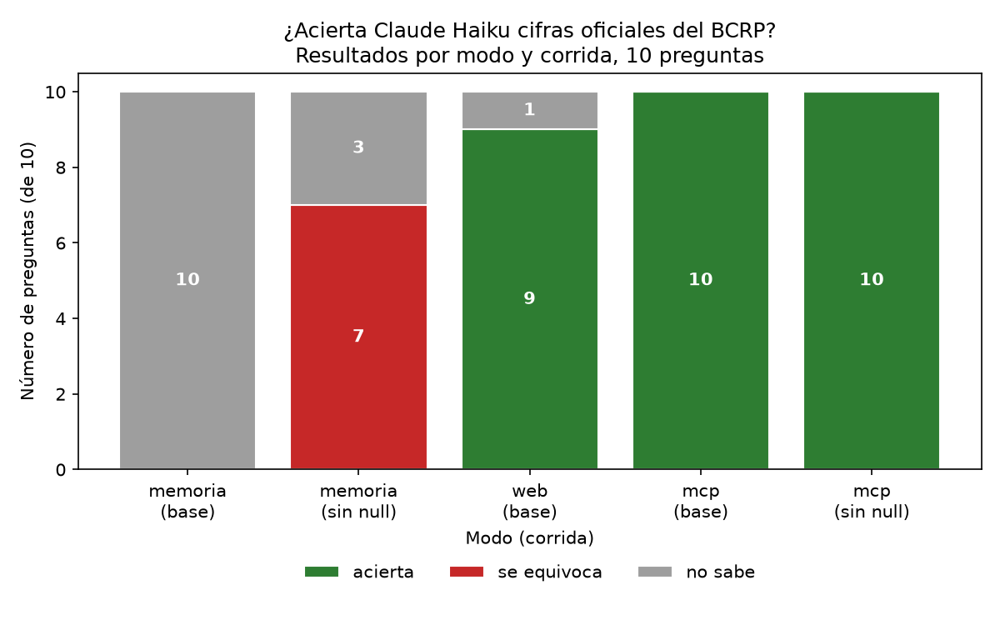

# ¿Inventa cifras Claude? Memoria, búsqueda web y MCP del BCRP

Diez preguntas de dato puntual (`preguntas.csv`), respondidas por Claude Haiku con `claude -p` en tres modos:
**memoria** (sin herramientas), **web** (WebSearch y WebFetch) y **mcp** (solo el servidor `bcrp` de este repositorio).
Cada respuesta se califica contra la cifra oficial con la tolerancia de cada pregunta (`evaluar.py`).

Datos: `resultados_base.csv` (memoria y mcp), `resultados_sin_null.csv` (memoria y mcp, con `--sin-null`)
y `resultados_web.csv` (web). Gráfico: `grafico.png`.

El gráfico se regenera con uv run grafico.py

## 1. Resultados por modo

| Modo | Corrida | Acierta | Se equivoca | No sabe | Segundos promedio |
|---|---|---:|---:|---:|---:|
| memoria | base | 0 | 0 | 10 | 5.4 |
| web | base | 9 | 0 | 1 | 21.6 |
| mcp | base | 10 | 0 | 0 | 12.3 |
| memoria | sin null | 0 | 7 | 3 | 10.1 |
| mcp | sin null | 10 | 0 | 0 | 12.6 |

La corrida web se hizo aparte, con los mismos parámetros por defecto (Haiku, `--paralelo 4`). Terminó al primer
intento en unos 62 segundos y no tuvo errores por límite de pedidos.

## 2. Fallos clasificados

Categorías: no sabía / buscó mal / serie equivocada / formato / error técnico. La clasificación se basa en la columna `fuente`.

**Memoria, base: 10 de 10 "no sabe", todos del tipo *no sabía*.** En las diez respuestas, `fuente` dice que no hay
acceso a datos del BCRP en la sesión y que no estima la cifra. En varias agrega que su conocimiento llega hasta
junio de 2026. Ninguna da un número.

**MCP, base y sin null:** no hay fallos.

**Web: 1 fallo.**

| id | Resultado | Clasificación | Qué dice `fuente` |
|---|---|---|---|
| cobre_ago26 | no sabe | buscó mal | Encontró la serie **anual** del cobre (PM40090BA), que llega hasta 2025, y "no pude acceder a la serie mensual" (la de la pregunta es PN38784BM). Descartó las cifras de prensa (Cochilco) por ser promedios parciales de otra fuente. |

Los 9 aciertos de web no tienen todos el mismo respaldo. Según `fuente`:

- **Leídos en BCRPData:** tc_15oct26, tamn_set26 y tot_ago26 (en esta última aclara que el valor vino de "una
  página web leída por un resumidor"), y referencia_set26, corroborado además con prensa.
- **rin_ago26:** usó otra serie (PN06481IM, no PN00027MM). Además anotó que PN00028MM da 96612, una
  diferencia de 94 millones que no pudo explicar. Respondió 96518, a 0.1 de la cifra oficial (96517.9), así que no
  dependió de la tolerancia de 100. Esa tolerancia sí habría aceptado los 96612 de PN00028MM, que están a 94.1.
- **Tomados de prensa o del INEI, no del BCRP:** ipc_set26 (El Comercio, Andina), ipc_dic25 (resultados de búsqueda
  de BBVA Research y El Comercio, sin abrir el original), ipc_mar25 (Forbes Perú y una nota de estudios del BCRP)
  y pbi_2025 (Forbes Perú, Andina, Expreso). En pbi_2025 respondió 3.44 y la cifra oficial es 3.4306: está dentro de la tolerancia de 0.05.

## 3. Experimento sin null

Con `--sin-null` se quita de la instrucción la frase «Si no puedes saberlo con certeza, pon valor null: no estimes.»
y el esquema solo acepta un número en `valor`. El modo MCP no cambia (10/10). En el modo memoria, las 10 respuestas
son de tres tipos:

| Tipo | Preguntas | Valor | Cómo lo cuenta el script |
|---|---|---|---|
| Estimación declarada no verificada | ipc_dic25, ipc_mar25, pbi_2025 | 1.70, 0.14, 3.00 | se equivoca |
| Cero usado como marcador | ipc_set26, tc_15oct26, rin_ago26, cobre_ago26 | 0 | se equivoca |
| Rechazo del esquema, sin número | referencia_set26, tamn_set26, tot_ago26 | vacío | no sabe |

El script cuenta los 7 primeros como "se equivoca", pero **solo 3 son estimaciones reales**. En los cuatro ceros,
`fuente` aclara que no obtuvo el dato. En tc_15oct26, rin_ago26 y cobre_ago26 dice además, de forma explícita,
que "el valor 0 es un marcador". En los tres de estimación, `fuente` empieza con "Estimación de memoria, no
verificada" o algo equivalente.

**El aviso de "no verificado" va en `fuente`, no en `valor`.** Quien lea solo el número (un script, una tabla,
otro agente) recibe 1.70 o 0 sin ninguna advertencia. En los tres rechazos, el modelo intentó responder sin número,
el esquema no lo aceptó y la llamada terminó sin `structured_output`.

## 4. Hallazgos técnicos

- **`evaluar.py` fallaba en Windows:** decodificaba la salida de `claude -p` como cp1252. Se corrigió con
  `encoding="utf-8", errors="replace"` en `subprocess.run`.
- **El prompt `informe` solo recibe una palabra como tema:** Claude Code separa los argumentos por espacios y no
  interpreta las comillas.
- **La API del BCRP:** devuelve "Sep" para setiembre y responde con content-type `text/html`, aunque el contenido es JSON.
- **El campo `actualizada` del catálogo va por detrás de los datos reales.** Por ejemplo, PD04638PD figuraba como
  actualizada el 2026-10-23, pero `ultimo_dato` ya devolvía el dato del 2026-10-27.
- **El `@` del recurso funcionó** cuando Claude lo leyó con `readMcpResource`. La ficha `bcrp://serie/{codigo}` no
  incluye el campo "grupo", aunque `buscar_series` también busca por grupo.

## 5. Verificación a mano de las dos preguntas nuevas

Consultadas en BCRPData el 28/10/2026:

| Pregunta | BCRPData (web) | MCP | Tolerancia | Fuente |
|---|---:|---:|---:|---|
| TAMN, setiembre 2026 (PN07807NM) | 16.9 | 16.893 | 0.06 | https://estadisticas.bcrp.gob.pe/estadisticas/series/mensuales/resultados/PN07807NM/html |
| Términos de intercambio, agosto 2026 (PN38923BM) | 186.0 | 185.97 | 0.1 | https://estadisticas.bcrp.gob.pe/estadisticas/series/mensuales/resultados/PN38923BM/html |

La web de BCRPData muestra las cifras redondeadas a un decimal, mientras que la API (y por tanto el MCP) da más
decimales. Por eso la "verdad" se fijó con el valor de la web y la tolerancia cubre la diferencia de redondeo:
una respuesta exacta de la API (16.893, 185.97) y una copiada de la web (16.9, 186.0) cuentan las dos como acierto.

## 6. Limitaciones

- **Muestra pequeña:** una sola corrida por modo, con Haiku, y 10 preguntas de dato puntual. Es justo el tipo de
  pregunta que mejor resuelve un MCP. No se evaluaron preguntas de análisis, comparación ni series largas.
- **El contraste con memoria era previsible:** todas las preguntas son de 2025-2026, posteriores al conocimiento
  del modelo.
- **No se midió por qué el MCP fue más lento:** 12.3 s frente a 5.4 s de memoria. Web fue aún más lento (21.6 s).
- **El modo memoria sabía que había un MCP:** varias respuestas mencionan el `.mcp.json` del proyecto. El modelo
  sabía que existía el servidor aunque no podía usarlo.
- **La corrida web se hizo aparte:** no fue en el mismo momento que las otras dos, así que la red y los sitios
  consultados pudieron estar en condiciones distintas.

## 7. Conclusión

Para cifras oficiales puntuales, el MCP acertó las 10 preguntas en las dos corridas, siempre con código de serie,
periodo y URL de la API. La búsqueda web acertó 9, pero 4 de ellas se apoyaron en prensa o en el INEI, una usó
otra serie del BCRP y no logró encontrar la serie mensual del cobre. Un MCP vale la pena cuando la cifra debe ser
trazable a la serie oficial, se consulta seguido o se usa en un proceso automático. La búsqueda web basta para
consultas ocasionales en las que una fuente secundaria es aceptable y alguien revisa la respuesta. Sin herramientas,
el modelo no debería responder estas preguntas: si se le obliga a dar un número, el aviso queda en `fuente` y el
número llega solo.
